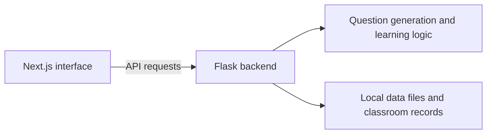

# EduPro — Adaptive Tutoring Platform

A collaborative prototype for **personalized Grade 2 math practice**, designed around the different needs of students, teachers, and parents.

**Stack:** Next.js · React · JavaScript · Flask · Python

## Overview

EduPro explores a more structured way to deliver practice questions, guided hints, and progress views to different users. The project combines a Next.js frontend with a Flask API and supporting Python modules for practice-question generation and classroom workflows.

### Key workflows

- **Students:** access practice and learning-progress views.
- **Teachers:** work with classroom and student-progress interfaces.
- **Parents:** use role-specific views designed around students' learning.
- **Application services:** API routes for account setup, login, classroom interactions, and progress-related operations.

The repository is a **prototype**, not a production educational product.

## Architecture



## Requirements and design

The six-person team designed role-specific workflows and iterated on user-facing features. The project explored user flows, use cases, and interface planning before and during implementation.

## Run the frontend

```bash
npm install
npm run dev
```

Open `http://localhost:3000`. The complete experience may require separate Python/Flask backend setup and suitable local development data; frontend startup alone does not guarantee that every feature is usable.

## Repository layout

- `app/` — Next.js pages and role-specific routes
- `components/` — reusable interface components
- `contexts/` — frontend application state
- `backend/` — Flask routes, question generation, and supporting modules

## Development and security notes

This is a learning/prototyping codebase. Authentication, data storage, and local configuration require further security review before deployment with real users or sensitive records. Do not use live personal data or real credentials when testing it.

## Team credit

Built collaboratively by a **six-person development team**. The Git history records individual contributions. This portfolio entry describes the team project rather than claiming sole authorship.
